<div align="center">

# Qbank · بنك الأسئلة

**Turn scanned workbooks into a searchable question bank, then build print-ready exams in minutes.**

[](https://github.com/Mahmoud-s-Khedr/qbank/actions/workflows/ci.yml)
[](LICENSE)


[Features](#features) · [How it works](#how-it-works) · [Quick start](#quick-start) · [Development](#development) · [Roadmap](#roadmap) · [Docs](#documentation)

</div>

---

Teachers, schools and education centers have thousands of good questions locked inside printed workbooks.
**Qbank** reads those scanned PDFs with multimodal AI. It extracts every question, choice, equation,
diagram and table, keeps the chapter and lesson structure, and stores the results in a structured bank.
A reviewer checks everything side-by-side with the original page. Teachers then build customized exams
and export them as **print-ready PDF** and **editable Word** files, with answer keys and multiple versions.

It is built **Arabic-first** (right-to-left text, tashkeel, Arabic-Indic digits) and also handles English,
math notation (LaTeX) and chemistry formulas.

> [!NOTE]
> Qbank is in **early development**. The foundation (backend, frontend, auth, data model) is in place.
> The extraction pipeline, review UI and exam export are being built now. See the [roadmap](#roadmap).

## Features

| | |
|---|---|
| 📄 **Ingest any scanned workbook** | Upload PDFs of up to 1,000 pages. Pages render in parallel, and damaged pages are isolated instead of failing the whole book. |
| 🧠 **Vision-based extraction** | Each page is read from its image (embedded text layers in Arabic PDFs are often garbled). Extracts questions, choices, answers, shared passages and poems, figures, tables and LaTeX math, with bounding boxes. |
| 🗂️ **Structure-aware** | Detects chapters, lessons and exams, stitches questions that span pages, skips covers and answer sheets, and matches answer keys. |
| ✅ **Automated validation** | Flags missing choices, figures referenced but not attached, truncated stems, numbering gaps, bad LaTeX and near-duplicates. An optional second model cross-checks low-confidence pages. |
| 🔍 **Side-by-side review** | The original page with overlaid boxes on one side, an editable question with live rendering on the other. Re-crop figures, split or merge questions, re-extract with a stronger model, and approve in bulk. |
| 🏦 **Searchable bank** | Arabic-aware full-text search (diacritics- and alef-insensitive) with filters by subject, chapter, lesson, type, difficulty and source. |
| 📝 **Three ways to build an exam** | Blueprint (counts per chapter × type × difficulty), hand-picked, or AI-assisted ("a 45-minute biology test on chapter 2, mostly medium"). The AI only selects approved questions. It never invents them. |
| 🔀 **Multiple versions** | Deterministic shuffling of questions and choices. Passage groups stay together, and "all of the above" stays last. |
| 🖨️ **Professional export** | A4 PDF and DOCX with native Word equations, school header and logo, RTL layout, answer keys and optional bubble sheets. |
| 💸 **Cost control** | Every LLM call is metered. Models are configurable per pipeline stage, with a monthly spend cap per organization. |

## How it works

```mermaid
flowchart LR
    A[📄 PDF upload] --> B[Render pages]
    B --> C[Classify page &<br/>extract with vision LLM]
    C --> D[Stitch cross-page items<br/>& crop figures]
    D --> E[Chapters, lessons<br/>& answer keys]
    E --> F[Validate · verify<br/>· classify · dedup]
    F --> G[👀 Human review]
    G --> H[(Question bank)]
    H --> I[Exam builder<br/>blueprint · manual · AI]
    I --> J[🖨️ PDF / DOCX<br/>+ answer keys]
```



Every model call goes through [OpenRouter](https://openrouter.ai), so each pipeline stage (extraction, verification,
classification, composition) can use whichever model scores best on our golden test set for cost and accuracy.
See [`docs/MODELS.md`](docs/MODELS.md).

## Tech stack

| Layer | Technology |
|---|---|
| **API** | Python 3.12 · FastAPI · Pydantic v2 · SQLAlchemy 2 · Alembic |
| **Workers** | Dramatiq + Redis · PyMuPDF · OpenCV |
| **AI** | OpenRouter (OpenAI-compatible SDK), structured JSON-schema outputs |
| **Data** | PostgreSQL 18 (full-text search + `pg_trgm`) · S3-compatible object storage (MinIO in dev) |
| **Web app** | React 19 · TypeScript (strict) · Vite · Tailwind CSS v4 · shadcn/ui · TanStack Query · i18next |
| **Export** | Jinja2 + headless Chromium (PDF) · Pandoc (DOCX with OMML equations) · KaTeX |
| **Quality** | ruff · mypy (strict) · pytest · ESLint (strict-type-checked) · Prettier · Vitest · Playwright · GitHub Actions |

## Quick start

**Prerequisites:** Docker with Compose v2, [uv](https://docs.astral.sh/uv/) (it installs Python 3.12 for you), Node 22 and pnpm 10.

```bash
git clone https://github.com/Mahmoud-s-Khedr/qbank.git
cd qbank
cp .env.example .env              # add your QBANK_OPENROUTER_API_KEY for extraction

make infra-up                     # PostgreSQL, Redis and MinIO on ports 25432 / 26379 / 29000
make be-install fe-install        # backend and frontend dependencies
make be-migrate                   # apply database migrations
uv run --directory backend python -m qbank.cli seed-dev   # demo org, users and subjects
```

Then start the two dev servers in separate terminals:

```bash
uv run --directory backend uvicorn qbank.api.main:app --reload   # API at http://localhost:8000 (docs at /docs)
pnpm -C frontend dev                                             # Web app at http://localhost:5173
```

Sign in with `admin@demo.local`, `editor@demo.local` or `teacher@demo.local`. The password is `demo1234`.

## Development

Everything CI runs is available locally through `make`:

| Command | What it does |
|---|---|
| `make check` | Every quality gate: lint, format, types, tests, build |
| `make be-lint` / `be-types` / `be-test` | ruff, mypy (strict), pytest (≥ 80% coverage, needs `make infra-up`) |
| `make fe-lint` / `fe-types` / `fe-test` / `fe-build` | ESLint + RTL guard, `tsc`, Vitest, production build |
| `make api-gen` | Regenerate `backend/openapi.json` and the typed frontend client |
| `make infra-up` / `infra-down` | Start or stop local infrastructure |

A few rules keep the codebase consistent:

- **Typed API contract.** The frontend only talks to the backend through a client generated from the OpenAPI schema. CI fails if the schema and client drift apart.
- **RTL by construction.** A lint rule rejects physical-direction Tailwind classes (`ml-*`, `text-left` …) in favour of logical ones (`ms-*`, `text-start`).
- **No real LLM calls in tests.** Tests use a fake client or recorded responses. Real-model benchmarks run on demand.
- **Tenant isolation.** Every query is scoped to the caller's organization. Another organization's resources return 404.

The sample workbooks used for pipeline tests are copyrighted and not included. See [`fixtures/README.md`](fixtures/README.md).

## Project structure

```
backend/      FastAPI app, workers, pipeline, exam and export engines (package: qbank)
frontend/     React web app (Arabic-first, RTL/LTR)
docs/         Specification, architecture, model selection, task board
fixtures/     Golden ground-truth annotations (sample PDFs are local-only)
scripts/      Repository tooling
```

## Roadmap

- [x] **Phase 0: Foundation.** Backend and frontend scaffolds, data model, cookie auth with CSRF, roles, multi-tenancy, taxonomy API
- [ ] **Phase 0: CI.** GitHub Actions quality gates, pre-commit, Dependabot, secret scanning *(in progress)*
- [ ] **Phase 1: Ingestion.** Storage, upload, page rendering *(in progress)*, LLM layer, extraction, structure detection, model benchmark
- [ ] **Phase 2: Validation.** Rules engine, confidence scoring, verifier pass, Arabic normalization, deduplication
- [ ] **Phase 3: Review.** Page canvas with boxes, question editor, split/merge, re-crop, re-extract with diff
- [ ] **Phase 4: Bank.** Search with facets, bulk edit, taxonomy manager
- [ ] **Phase 5: Exams.** Blueprint sampler, manual builder, AI-assisted composition, versions
- [ ] **Phase 6: Export.** PDF and DOCX, answer keys, bubble sheets, header templates
- [ ] **Phase 7: Hardening.** End-to-end tests, security review, production deployment

The detailed, live task board is in [`docs/TASKS.md`](docs/TASKS.md).

## Documentation

| Document | Contents |
|---|---|
| [`docs/SPEC.md`](docs/SPEC.md) | Product specification: roles, functional requirements, acceptance criteria |
| [`docs/ARCHITECTURE.md`](docs/ARCHITECTURE.md) | System design, data model, pipeline, content format, CI |
| [`docs/MODELS.md`](docs/MODELS.md) | OpenRouter model candidates per pipeline stage, and benchmark results |
| [`docs/TASKS.md`](docs/TASKS.md) | Task board and dependencies |
| [`AGENTS.md`](AGENTS.md) | Rules for contributors (human or AI): commands, definition of done |

## How this project is built

Qbank is developed by a small team of AI coding agents working from the specs in [`docs/`](docs/).
[Claude Code](https://claude.com/claude-code) acts as architect and reviewer: it writes each task's spec, reviews every
change and runs the full checks before merging. [Codex](https://github.com/openai/codex) builds most of the backend,
and [Antigravity](https://antigravity.google) builds the frontend and the golden dataset. Each task runs in its own git
worktree, and nothing reaches `main` without passing `make check`.

## License

[MIT](LICENSE) © 2026 Mahmoud Khedr
